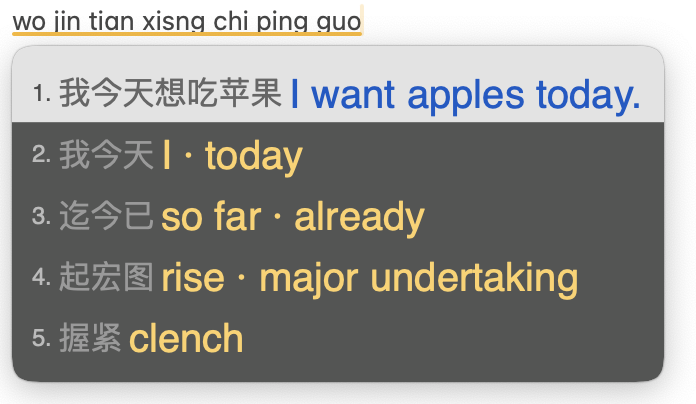
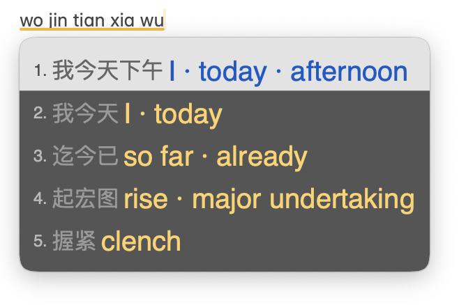

# 打中文，顺便背单词

**type-chinese-learn-english** · 一个 macOS 中文输入法：平时怎么打中文就怎么打，每个候选词旁边自动显示英文，打字的同时顺便学英语。

基于 Rime 输入法（鼠须管 + 雾凇拼音 + 万象语法模型），**全部在本机运行，不联网上传任何输入内容**。一行命令装好，一条命令更新。当前版本 **v1.3**，改动见 [CHANGELOG.md](CHANGELOG.md)。

- **打字准**：整句拼音一口气打完，首选就是对的。实测 199 句日常、工作、学习用语，整句完全正确 92%，逐字正确 98.7%。
- **词**：查本地词表（13 万条，最常用的 3000 多个字词逐个人工核对过），例如「质量 quality」「握紧 clench」。
- **整句**：首选候选交给本机翻译模型，例如「明天下午三点开会 We'll meet tomorrow at 3:00 p.m.」；模型没把握时改用逐词对照。
- **半句**：逐词对照，不让模型“脑补”，例如「我今天下午 I · today · afternoon」「帮我拿一下快递 help · me · take · a bit · express delivery」。
- **直接出英文**：按 Ctrl+Shift+回车，上屏的是英文而不是中文。

| 整句：首选交给本机模型翻译 | 半句：逐词对照，不让模型脑补 |
|---|---|
|  |  |
| 首选整句显示通顺的英文译文（截图来自 v1.0，当时开着邻键纠错，所以打错的 `xisng` 也出了「想」；v1.3 起默认关闭，原因见更新记录） | 「我今天下午」显示 I · today · afternoon，而不是模型编出的 "I'm going to be here this afternoon." |

## 安装：一行命令

1. 打开「终端」（按 ⌘+空格，输入「终端」或 Terminal，回车）。
2. 复制下面这一行，粘贴到终端里，按回车：

   ```bash
   /bin/bash -c "$(curl -fsSL https://raw.githubusercontent.com/wjunlin293-tech/type-chinese-learn-english/main/install.sh)"
   ```

3. 中途会让你输入一次**开机密码**，用来安装输入法。输入时屏幕上不会显示，输完按回车即可。
4. 等 5–10 分钟，看到「装好了！」就完成了。输入法已经自动切换成鼠须管，打 `pingguo` 试试。

整个过程全自动，不用回答任何问题，也不用事先装 Homebrew、git 或 Python。

**需要：** macOS 13（Ventura）或更新，一个管理员账户，约 2.5GB 空闲磁盘，能访问 GitHub。

**中途断了？** 重新运行同一条命令即可，已经装好的部分会自动跳过。

**更新？** 同一条命令再运行一次就是更新（或者运行 `cn2en update`），会显示这次更新了什么。

**只想要基本功能？** 在命令末尾加参数：`--no-mt` 不装整句翻译（省约 1GB 磁盘、250MB 内存），`--no-grammar` 不下载语法模型（约 400MB）。例如：

```bash
/bin/bash -c "$(curl -fsSL https://raw.githubusercontent.com/wjunlin293-tech/type-chinese-learn-english/main/install.sh)" -- --no-mt
```

安装程序会：

- 第一次安装时备份你原有的 `~/Library/Rime`，包括打字记录和配置。语法模型、翻译模型这些能重新下载的大文件不备份，可省下约 1GB；
- 安装鼠须管官方安装包（核对 SHA-256）并加入输入法列表；
- 下载雾凇拼音、万象语法模型；
- 装好中英词表和插件；
- 装好本机翻译服务和模型（核对 SHA-256）；
- 最后列出每一部分是否成功。

所有细节记录在 `~/Library/Logs/cn2en.log`。

### 已经手动装过 v1.0？

直接运行上面那条命令就行，不用先卸载，也不用做别的。它会：

- **认出旧版**，按「从 v1.0 更新」处理，最后显示两个版本的更新内容；
- **自动搬运你的词表修正**：你在 `~/type-chinese-learn-english/data/overrides.tsv` 里自己加的、改过的条目（不管有没有 `git commit`），都会搬进不会被更新覆盖的个人词表；
- **保留你改过的外观设置**（如候选框颜色）；没改过的配置文件直接换成新版；
- **沿用已有的东西**：鼠须管、雾凇拼音、语法模型、翻译模型都不重新下载，打字记录不动；
- 先备份 `~/Library/Rime`，跳过模型等大文件。

装好后，旧的 `~/type-chinese-learn-english` 就用不到了，可以删掉。以后更新运行 `cn2en update` 即可。

## 怎么用

| 操作 | 作用 |
|---|---|
| 正常打字 | 候选旁边显示英文 |
| **Ctrl+Shift+回车** | 直接输出当前候选的英文 |
| **Ctrl+Shift+E** | 打字时临时开/关英文 |
| **F4**（或 Ctrl+`） | 方案选单：「中英 / 纯中」切换是否显示英文，「整句 / 查词」切换首选是否整句翻译；选择会被记住 |

## 管理：cn2en 命令

装好后在终端里可以用 `cn2en` 命令：

| 命令 | 作用 |
|---|---|
| `cn2en fix 质量 quality, grade` | 某个词的英文不对，一条命令改掉，立即生效 |
| `cn2en fix 质量 -` | 不再显示这个词的英文 |
| `cn2en fix --undo 质量` | 撤销你的修正 |
| `cn2en fixes` | 列出你的修正（保存在 `~/Library/Rime/cn2en_user.tsv`，更新不会覆盖） |
| `cn2en update` | 更新到最新版，并显示更新内容；你的修正和改过的外观设置都保留 |
| `cn2en status` | 逐项检查是否正常，有问题会告诉你怎么修 |
| `cn2en mt off` / `cn2en mt on` | 关掉/打开本机翻译服务（关掉省约 250MB 内存，首选整句改为逐词对照） |
| `cn2en uninstall` | 卸载（保留个人修正）；`cn2en uninstall --all` 连鼠须管和雾凇一起删 |

如果终端提示找不到 `cn2en`，关掉终端窗口重新打开一个即可。

## 遇到问题

先运行 `cn2en status`，它会逐项检查并给出修复办法。常见情况：

- **安装时提示「连不上 GitHub」**：检查网络；公司或学校网络可能需要代理，开好代理后重新运行安装命令。
- **提示需要 macOS 13**：在「系统设置 → 通用 → 软件更新」升级系统后再装。
- **输入法菜单里没有鼠须管**：先注销再登录一次；还没有的话，在「系统设置 → 键盘 → 文字输入 → 编辑… → +」里添加「简体中文 → 鼠须管」。
- **整句没有英文，只有逐词对照**：可能是模型对这句没把握（正常现象），也可能是翻译服务没在运行，这时运行 `cn2en mt on`。
- **安装时弹出「命令行开发者工具」窗口**：这是整句翻译需要的 Python，点「安装」，装好后会自动继续；点「取消」只是不装整句翻译。
- **想恢复到安装前的样子**：运行 `cn2en uninstall --all`，然后把第一次安装时备份的 `~/Library/Rime.bak-<日期>` 改回 `~/Library/Rime`。备份里不含语法模型，需要的话重新运行安装命令补回。

解决不了的话，把 `~/Library/Logs/cn2en.log` 附在 [Issue](https://github.com/wjunlin293-tech/type-chinese-learn-english/issues) 里。

## 工作原理

```
拼音 ─▶ 雾凇拼音(+万象语法模型) ─▶ 候选 ─▶ cn2en.lua 过滤器 ─▶ 候选 + 英文注释
                                            │
            个人词表 / 词表命中 ◀── cn2en_user.tsv、cn2en.tsv
                     首选整句 ──▶ 127.0.0.1:18085 本机翻译服务（超时 0.3 秒即放弃，不卡打字）
                              └─▶ 检查译文（长度 / 模型把握），不通过 ─┐
                     其余半句 ──▶ 按词频分词，逐词对照 ◀──────────────┘
```

- 首选候选的模型译文要过两道检查，不通过就改用逐词对照：
  - **长度**：英文词数远多于逐词对照的词数，判定为模型给半句脑补了内容；
  - **把握**：模型给这条译文的平均对数概率低于 −1.0，说明它在硬译、瞎猜，例如「躺平了 → Lie down.」会改显示 lie flat。这个阈值是用真模型跑 150 多句日常/工作/学习/网络用语后定的。
- 逐词对照按词频算整句概率最大的切法（「研究/生命」而不是「研究生/命」，「很/好吃」而不是「很好/吃」），并处理常见搭配：
  - 量词：数词、指示词后的量词不翻译（「三本书 three · book」「这道菜 this · dish」）；
  - 代词：动词、介词后用宾格（「帮我 help · me」），后面跟「的」用所有格（「我的电脑 my · computer」「这是我的 … mine」）；
  - 介词与方位词：「他对我很好 he · to · me」「发给我 send to · me」「我马上到 … arrive」「市场上 market · on」。
- 语气词（了、吗、呢、吧……）：首选候选带语气词时 2 个字起就整句翻译（「下雨了 It's raining.」）；逐词对照时跳过语气词，句末是「吗 / 呢」则补问号（「饿了吗 hungry?」）。
- 一页候选打包成一次请求；词表只在启动时加载一次；译文两级缓存（Lua 侧 + 服务侧）。
- 实测（Apple M1，v1.0）：一页 5 个候选整批翻译 70–100ms，缓存命中约 10ms。v1.1 起，服务对每条新译文多做一次打分（只过一遍模型，不逐词生成），耗时会略增，尚未在 M1 上重新实测。如果首选整句经常显示不出来，可以把 `cn2en.lua` 里的 `MT_TIMEOUT` 调大一点。

## 开发者

### 测试

```bash
lua tools/test_cn2en.lua tools/test_cases.txt --no-mt --check   # 词表与逐词对照的回归测试，全部通过则无输出
```

```bash
lua tools/test_cn2en.lua tools/test_cases_mt.txt                # 整句抽查（需要翻译服务在运行）
```

需要 Lua：`brew install lua`。

- `test_cases.txt` 收了 80 多条以前实际出现过的错配，例如「奶奶 breasts」「很好吃 devastating · eat」「研究生命 graduate student · life」。
- `test_cases_mt.txt` 是 200 多句长短、语境各不相同的句子。GitHub Actions（`.github/workflows/model.yml`）每次改动都会用真模型跑一遍，日志里有原始译文、把握分和输入法最终显示的内容。

**整句组词评测**（`tools/ime_bench/`）：把 `corpus.tsv` 里 199 句的拼音整句打进真实的 Rime（雾凇拼音 + 本仓库配置 + 万象语法模型），统计首选候选完全正确的比例。改语法模型参数、纠错等设置前后各跑一次。需要 Linux 上的 librime 和插件（`apt install librime-dev librime-plugin-lua librime-plugin-octagram`）：

```bash
tools/ime_bench/run.sh <雾凇拼音目录> <wanxiang-lts-zh-hans.gram>
```

| 配置 | 整句完全正确 | 逐字正确 |
|---|---|---|
| v1.0–v1.2：只设一个语法参数，开邻键纠错 | 60.3% | 90.3% |
| 不用语法模型，关邻键纠错 | 87.9% | 97.1% |
| v1.3：推荐语法参数，关邻键纠错 | **92.0%** | **98.7%** |

### 修正词表（提交给所有人）

`cn2en fix` 只改你自己的电脑。想让修正进入公共词表，在 `data/overrides.tsv` 里加一行 `中文<TAB>英文`，英文写 `-` 表示删掉这个词，然后合并：

```bash
python3 tools/apply_overrides.py data/cn2en.tsv data/overrides.tsv
```

英文的第一个释义会用在逐词对照里，所以把放进句子里最自然的那个写在前面（如 `就	just, then`）。

想从数据源完整重新生成（例如 CC-CEDICT 更新了），依次运行：

```bash
curl -L -o /tmp/cedict.zip https://www.mdbg.net/chinese/export/cedict/cedict_1_0_ts_utf-8_mdbg.zip && unzip -o /tmp/cedict.zip -d /tmp
```

```bash
curl -L -o /tmp/ecdict.csv https://raw.githubusercontent.com/skywind3000/ECDICT/master/ecdict.csv
```

```bash
curl -L -o /tmp/jieba_dict.txt https://raw.githubusercontent.com/fxsjy/jieba/master/jieba/dict.txt
```

```bash
python3 tools/build_cn2en.py /tmp/cedict_ts.u8 /tmp/ecdict.csv data/cn2en_ecdict_reverse.tsv data/cn2en.tsv data/overrides.tsv
```

```bash
python3 tools/build_freq.py /tmp/jieba_dict.txt data/cn2en.tsv data/overrides.tsv data/cn2en_freq.tsv
```

### 从源码安装

```bash
git clone https://github.com/wjunlin293-tech/type-chinese-learn-english.git && type-chinese-learn-english/bin/cn2en install
```

这样装的话，`cn2en` 命令指向这个克隆。改完代码再运行一次 `bin/cn2en install` 就会同步到输入法。

### 发布新版本

1. 修改 `VERSION`，在 `CHANGELOG.md` 顶部加一节 `## vX.Y.Z — 标题`。
2. 合并到 `main`。`.github/workflows/release.yml` 会自动发布 Release `vX.Y.Z`，说明取自这一节；用户运行 `cn2en update` 时也会看到这一节的标题和小标题。

翻译模型只在 `tools/convert_model.sh` 变化时才需要重新发布：把工作流里的 `MODEL_TAG` 改成新的标签，同时修改 `bin/cn2en` 里的 `MODEL_URL`。

### 文件说明

| 路径 | 作用 |
|---|---|
| `install.sh` | 一行安装的入口：下载程序到 `~/Library/Application Support/cn2en`，然后运行 `cn2en install` |
| `bin/cn2en` | 安装、更新、状态检查、修词、开关翻译服务、卸载 |
| `VERSION`、`CHANGELOG.md` | 版本号与更新记录（`cn2en update` 读取） |
| `mac/lua/cn2en.lua` | Rime Lua 过滤器：查词表、整句请求本机翻译并检查、半句按词频分词逐词对照、开关 |
| `mac/rime_ice.custom.yaml` | 雾凇拼音补丁：挂载过滤器、语法模型参数、开关与快捷键 |
| `mac/default.custom.yaml` | 方案菜单只保留雾凇拼音；记住英文开关 |
| `mac/squirrel.custom.yaml` | 鼠须管外观：英文 20 号暖黄、中文 16 号灰色 |
| `mac/cn2en_user.tsv.template` | 个人词表模板 |
| `mac/mt/server.py` | 本机翻译服务，只监听 127.0.0.1，不记录任何输入 |
| `mac/mt/local.cn2en-mt.plist.template` | 开机自启（LaunchAgent）模板 |
| `data/cn2en.tsv` | 中文 → 英文词表（约 13.2 万条） |
| `data/overrides.tsv` | 手工校正表，优先级最高 |
| `data/cn2en_freq.tsv` | 词频（来自 jieba），逐词对照时分词用 |
| `data/cn2en_ecdict_reverse.tsv` | ECDICT 反查表，CC-CEDICT 未收录时的回退 |
| `tools/apply_overrides.py` | 把 `overrides.tsv` 合并进 `cn2en.tsv` |
| `tools/build_cn2en.py`、`tools/build_freq.py`、`tools/build_ecdict_reverse.py` | 从数据源生成词表、词频、反查表 |
| `tools/convert_model.sh` | 把 OPUS-MT 转成 CTranslate2 int8（Actions 用它发布模型；下载不了时安装程序在本机用它） |
| `tools/test_cn2en.lua`、`tools/test_cases*.txt` | 测试脚本与用例 |
| `tools/ime_bench/` | 整句组词评测：最小 Rime 控制台、评测脚本、199 句拼音语料 |
| `.github/workflows/release.yml` | `VERSION` 变化合并到 main 后，自动发布对应的 Release |
| `.github/workflows/model.yml` | 转换并发布翻译模型，用真模型抽查整句 |

## 外观

鼠须管 1.1.2 的候选框不支持把注释画在候选词**上方**：在 `candidate_format` 里插入换行，会导致面板高度计算错误、内容跳到最后一行。所以英文显示在中文**右侧**，用更大的字号和更醒目的颜色区分。

颜色在 `~/Library/Rime/squirrel.custom.yaml` 里改（格式为 `0xBBGGRR`），改完运行 `cn2en reload`。你改过的这个文件在更新时会保留。

## 已知局限

- 目前只有 macOS 版。iPhone（仓输入法）版尚未在真机上测试，测试通过后再加入本仓库。
- 英文在候选词右侧，不在正上方（见上节）。
- 词表对多义词只取 1–2 个最常用的英文，具体语境下可能不是最合适的那个；逐词对照只对量词、代词、「对/给/到」和方位词做了语境处理。
- 本地小模型偶尔会译错意思但用词通顺，把握分也不低，这类拦不住，例如「我每天背二十个单词 → I'm carrying 20 words every day.」。打字到一半的半句也可能被译成别扭的整句，例如「你明天早上 → You'll be in the morning.」。
- 逐词对照只是词的拼接，不是通顺的英文句子。
- 翻译服务常驻后台，约占 200–300MB 内存（`cn2en mt off` 可关）。
- 邻键纠错（按偏到相邻键的字母也能打出对的字）默认关闭：开着会把拼对的拼音也「纠」错，整句正确率从 92% 掉到 74%。拼音打错了需要自己改。
- 整句组词偶尔仍会选错，多是光看拼音分不清的，如「的/得」「他/她」「吗/嘛」「一部/一步」。选对一次后，雾凇会记住你的选择。

## 许可

- 代码与配置（`bin/`、`mac/`、`tools/`、`install.sh`）：[MIT](LICENSE)
- 词表数据（`data/cn2en.tsv`、`data/overrides.tsv`）：CC BY-SA 4.0，衍生自 CC-CEDICT；ECDICT、jieba 部分为 MIT。详见 [data/LICENSE.md](data/LICENSE.md)
- 引用的第三方组件：见 [THIRD_PARTY_NOTICES.md](THIRD_PARTY_NOTICES.md)。安装时下载的翻译模型为 OPUS-MT zh-en（CC BY 4.0）。
